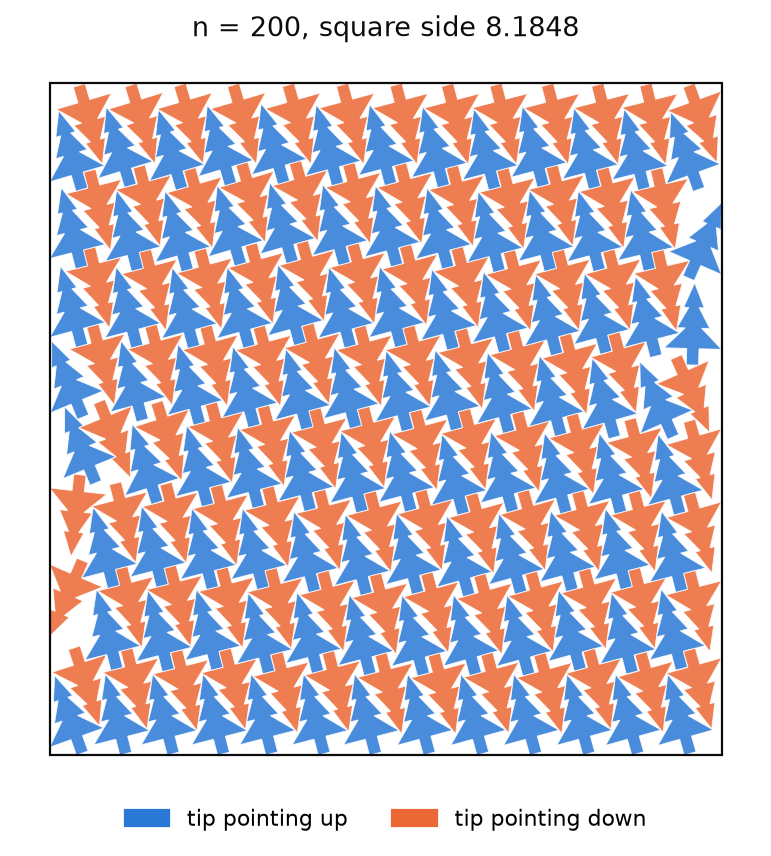
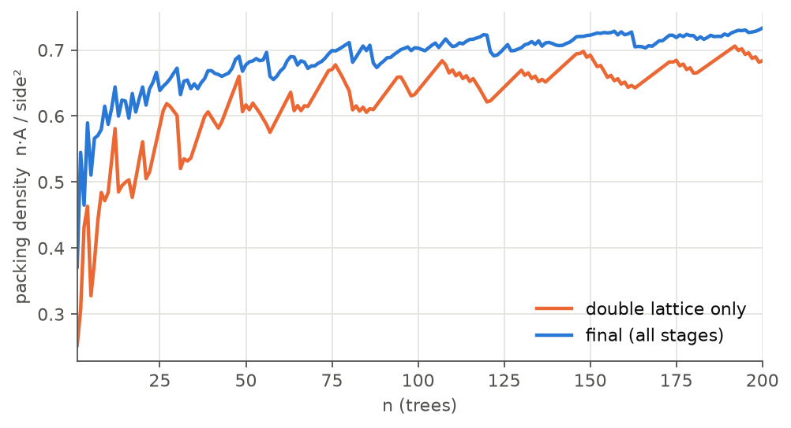
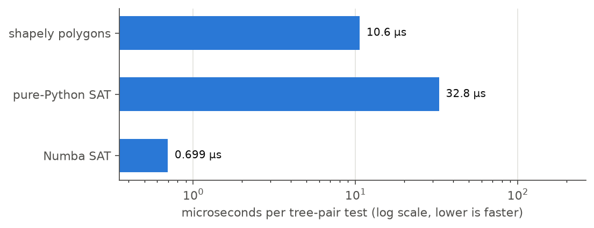

# santa2025-tree-packing

[](https://github.com/nuummm/santa2025-tree-packing/actions/workflows/ci.yml)

**A from-scratch Numba solver that packs 1–200 non-convex tree polygons into the smallest square, for every n.**
**Correctness is two-staged: a conservative separating-axis test during search, then an independent shapely check of every n from the written file.**
**Runs are reproducible (move budgets, in-kernel seeding); the full 200-instance run takes 24 minutes on a 10-core Apple M5 and scores 72.0093.**



## Background

I won a bronze medal in the Kaggle competition
[Santa 2025 – Christmas Tree Packing Challenge](https://www.kaggle.com/competitions/santa-2025)
(rank 287 of 3,357 teams, private leaderboard score 70.2503). This repository is an
independent implementation written from scratch after the competition, starting from the
competition's published problem definition (statement, evaluation rule and the
official tree outline) and the general techniques listed under
[References](#references). Every number below comes from this code.

## Results

All numbers below come from one run of the command in [Reproduce](#reproduce) on
Apple M5 (10 logical cores, Python 3.12.13, Numba 0.68.1). The score is the one
computed by the final validator from the written `submission.csv`.

| | |
|---|---|
| Total score (sum of side² / n, lower is better) | **72.0093** |
| Wall time (lattice search 12 s, three seeds, ensemble, validation) | 24 min (1,413 s) |
| Configurations passing the final overlap check | 200 / 200 |

**Stacking table** — each stage starts from the previous one. Stages are run for
seeds 0, 1 and 2; the table shows each seed, the mean and the band totals of the mean.
The last row merges the three seeds per n
([benchmarks/ablation.csv](benchmarks/ablation.csv)):

| Stage | seed 0 | seed 1 | seed 2 | Mean | Δ mean | n 1–20 | n 21–100 | n 101–200 |
|---|---:|---:|---:|---:|---:|---:|---:|---:|
| double lattice | 80.2122 | 80.2122 | 80.2122 | 80.2122 | — | 11.1275 | 32.2735 | 36.8112 |
| + simulated annealing | 72.3578 | 72.3065 | 72.3547 | 72.3397 | -7.8725 | 8.6735 | 29.2041 | 34.4620 |
| + compaction | 72.3442 | 72.2941 | 72.3420 | 72.3268 | -0.0129 | 8.6733 | 29.2004 | 34.4531 |
| + remove-one cascade | 72.2672 | 72.2281 | 72.2713 | 72.2555 | -0.0713 | 8.6711 | 29.1608 | 34.4236 |
| + per-n ensemble of seeds 0,1,2 | | | | 72.0093 | -0.2462 | 8.6019 | 29.0632 | 34.3443 |

The lattice is deterministic, so its row is the same for every seed. The spread
between seeds after annealing (0.05) is larger than the compaction gain, but the
compaction and remove-one gains have the same sign and similar size in every seed.
The ensemble uses three times the compute of one seed; a single seed with three times
the moves has not been run, so the ensemble gain is not separated from the effect of
the extra compute.

**Density per n** (n·A / side², A = tree area). The lattice cut-out is loose for small n
and saw-toothed as n crosses row and column boundaries; annealing lifts every n.



Per instance, n 1–20 cost 0.43 on average against 0.34 for n 101–200, so small n are
where packing is loosest. At n = 200 the final density is 0.733 (side 8.1848), below the
0.790 of the infinite lattice the search found (cell area 0.6213 for two trees). The
gap is presumably loss at the walls of the square, which is what a next version would
target.

**Speed** ([benchmarks/collision.csv](benchmarks/collision.csv)): single process, JIT
compiled before timing, best of repeats, random pairs with centres 0.3–1.6 apart
(Numba timed on 5,000 pairs, shapely and pure Python on the first 1,000). Other jobs
were running on the machine, so treat the ratios as indicative. On all 5,000 pairs the
Numba test and shapely agreed; these pairs are mostly away from contact, and the
behaviour right at contact is covered by the tests.

| Implementation | Pair test (µs/pair) | Annealer, n = 200 (moves/s) |
|---|---:|---:|
| shapely polygons | 10.6 | 28,000 |
| pure-Python SAT | 32.8 | — |
| Numba SAT | **0.70** | **1,443,000** |

The like-for-like number is the pair test, about 15× faster in Numba. The annealer
rates are not like-for-like: the shapely annealer builds the moved polygon and tests it
against all others on every move, while the Numba annealer runs the Metropolis test
first and skips the collision test for rejected moves, so part of its higher rate
comes from doing less work per move.



## Design

* **Problem split.** The score is a sum over n, so the 200 instances are solved
  independently in a process pool, then improved jointly only by the remove-one
  cascade and the per-n ensemble.
* **Two-stage correctness.** During search, a pair is "clear" only if a disc, box or
  edge-normal test separates it by more than `eps = 1e-9` (four convex pieces per
  tree, 4×4 piece pairs). The final gate re-reads the CSV as `Decimal`, builds shapely
  polygons and checks `intersects and not touches` for every n. Only layouts that
  pass are written.
* **Determinism.** Budgets are move counts, not seconds, and the RNG is seeded inside
  the compiled kernel from `(seed, n)`, so the same command reproduces the same file
  byte for byte regardless of worker count (a test checks this on a small instance).
* **Pipeline.** double lattice → simulated annealing (boundary-biased moves) →
  compaction → remove-one cascade (n+1 → n) → per-n ensemble over seeds.

Details, the reasoning behind each choice, and limitations: [docs/design.md](docs/design.md).

## Reproduce

Quick check (n = 1..20, small budget; about 12 s on the machine above):

```bash
uv sync
uv run treepack solve --n-max 20 --moves-per-tree 2000 --seeds 0 1 --out results/demo
uv run treepack validate --partial results/demo/submission.csv
```

Full run and the committed tables and figures:

```bash
uv run treepack solve --moves-per-tree 250000 --seeds 0 1 2 --out results
uv run treepack validate results/submission.csv
uv run python scripts/run_ablation.py      # benchmarks/ablation.csv, sides.csv
uv run python scripts/bench_collision.py   # benchmarks/collision.csv
uv run python scripts/make_figures.py      # docs/figures/*.png
uv run pytest                              # unit + small end-to-end tests
```

`results/` is not committed; the full run regenerates `submission.csv` and the
per-stage metrics.

## Layout

```
src/treepack/
  geometry.py     tree polygon, convex pieces, transforms
  collision.py    Numba disc/box/SAT overlap test (conservative)
  validate.py     final gate (Decimal + shapely), all n
  scoring.py      side, score, density, per-band totals
  io.py           submission read/write ('s'-prefixed values)
  lattice.py      double-lattice search and square cut-outs
  anneal.py       simulated annealing (Numba)
  compact.py      greedy compaction (Numba)
  initializers.py remove-one
  ensemble.py     per-n best valid layout across runs
  pipeline.py     end-to-end solve, metrics.json
  cli.py          `treepack solve` / `treepack validate`
scripts/          benchmarks, ablation table, figures
tests/            pytest suite (geometry, collision vs shapely, validator, search, E2E)
```

## References

* Problem definition: *Santa 2025 – Christmas Tree Packing Challenge*, Kaggle, 2025:
  statement and evaluation pages, and the tree outline from the hosts' starter
  notebook. <https://www.kaggle.com/competitions/santa-2025>
* C. Ericson, *Real-Time Collision Detection*, 2004 (separating axis test).
* J. A. Bennell, J. F. Oliveira, "The geometry of nesting problems: a tutorial",
  *EJOR* 184(2), 2008 (convex decomposition for overlap tests).
* G. Kuperberg, W. Kuperberg, "Double-lattice packings of convex bodies in the
  plane", *Discrete Comput. Geom.* 5, 1990.
* S. Kirkpatrick, C. D. Gelatt, M. P. Vecchi, "Optimization by simulated annealing",
  *Science* 220, 1983.

## License

MIT, see [LICENSE](LICENSE). No competition data, third-party code or binaries are
included.

---

### 日本語の要約

Kaggle Santa 2025（1〜200 本のツリー多角形を最小の正方形に詰める問題）のソルバーです。
コンペでは銅メダル（287 位 / 3,357 チーム、Private スコア 70.2503）を取りました。
この repo は、コンペ終了後に、公開されている問題定義（問題文・評価方法・公式の
ツリー形状）と一般的な手法をもとに一から書き直した独立実装です。README の数値はすべてこの repo の
コードで得たものです。探索中は Numba の保守的な分離軸判定、最終確認は書き出した CSV を
Decimal と shapely で全 n 再検査する 2 段構成で、手数予算と seed 固定により同じコマンドで
同じ結果が再現されます。
